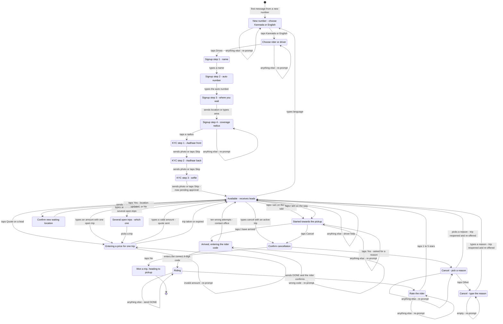

# Driver Flow

State machine for the driver side of the single WhatsApp number. Read `docs/overview.md` first for routing, data model, matching and subscription rules.

## Two ways in

| Path | Who starts it | Result |
|---|---|---|
| **Office-seeded** | Office staff inserts the driver (name, phone, vehicle, base location, radius) | `approval_status = 'approved'` immediately. The driver never signs up and never has to agree to anything. Their first-ever message resolves role from the `drivers` table and lands in `idle`. |
| **Self-signup** | Driver messages the number and taps **Driver** | Walks the signup states below, ends `approval_status = 'pending'`. **Receives no leads until office approves.** |

Both paths converge on the same `idle` state and the same lead handling.

## Signup states (self-signup only)

| Step | State | Prompt | Stored |
|---|---|---|---|
| 1 | `awaiting_driver_name` | "What's your name?" | `drivers.name` |
| 2 | `awaiting_vehicle_number` | "Your auto number? (e.g. KA-05-1234)" | `drivers.vehicle_no` |
| 3 | `awaiting_base_location` | "Send your location — where do you usually wait?" | `drivers.base_lat/lng` |
| 4 | `awaiting_radius` | "How far will you go for a trip?" → 2 / 3 / 5 / 8 km | `drivers.radius_km` |
| 5 | `awaiting_kyc_aadhaar_front` | "Send a photo of your Aadhaar (front)" — Skip allowed | `drivers.kyc_aadhaar_url` |
| 6 | `awaiting_kyc_aadhaar_back` | "Now the back" — Skip allowed | `drivers.kyc_aadhaar_back_url` |
| 7 | `awaiting_kyc_selfie` | "Send a selfie" — Skip allowed | `drivers.kyc_selfie_url` |
| 8 | `idle` (pending) | "Your details are with us. We'll message you once verified." | `approval_status = 'pending'` |

KYC images go to the restricted **`kyc`** storage bucket (never the public `photos` bucket) and are reviewed by office staff in Driver Detail. A driver who skips all three is still `pending` — the office can approve them if they were verified face to face, or reject for missing documents. Office-seeded drivers skip this entirely.

## States

| State | Meaning | Exits |
|---|---|---|
| `awaiting_role` | New number, no role | `role_driver` → `awaiting_driver_name` |
| `awaiting_driver_name` | Signup 1 | text → `awaiting_vehicle_number` |
| `awaiting_vehicle_number` | Signup 2 | text → `awaiting_base_location` |
| `awaiting_base_location` | Signup 3 | location → `awaiting_radius`; text → stored as `base_text` → `awaiting_radius` |
| `awaiting_radius` | Signup 4 | `radius_{n}` → `awaiting_kyc_aadhaar_front` |
| `awaiting_kyc_aadhaar_front` | Signup 5 | image → `awaiting_kyc_aadhaar_back`; `skip_kyc` → `awaiting_kyc_aadhaar_back` |
| `awaiting_kyc_aadhaar_back` | Signup 6 | image → `awaiting_kyc_selfie`; `skip_kyc` → `awaiting_kyc_selfie` |
| `awaiting_kyc_selfie` | Signup 7 | image or `skip_kyc` → `idle` (pending), docs saved |
| `idle` | Available, receives leads | see priority table |
| `awaiting_quote_amount` | Tapped Quote on a lead | valid number → quote created → `idle`; invalid → re-prompt |
| `awaiting_trip_pick` | Sent a bare number with several open trips | `pick_trip_{tripId}` → quote → `idle` |
| `trip_assigned` | Won a trip, not yet moving | `start_trip` → `en_route`; `arrived` (skipping the step) → `awaiting_ride_otp`; cancel → `awaiting_cancel_confirm` |
| `en_route` | Tapped I am on the way, heading to pickup | `arrived` → `awaiting_ride_otp`; cancel → `awaiting_cancel_confirm` |
| `awaiting_ride_otp` | Arrived, entering the rider's code | correct code → `ride_in_progress`; wrong → re-prompt (max 10) |
| `ride_in_progress` | Riding | `DONE` → rider confirms → `awaiting_rider_rating` |
| `awaiting_rider_rating` | Rate the rider | `rate_1`…`rate_5` → `idle` |
| `awaiting_base_confirm` | Sent a location while idle | `base_yes` → update → `idle`; `base_no` → `idle` |
| `awaiting_cancel_confirm` | Confirming cancellation | `cancel_yes` → `awaiting_cancel_reason`; `cancel_no` → back |
| `awaiting_cancel_reason` | Pick a reason for dropping the trip | `creason_*` → `idle` (trip reopened); `creason_other` → `awaiting_cancel_reason_text` |
| `awaiting_cancel_reason_text` | Type the reason | any text → `idle` (trip reopened) |
| `awaiting_language` | Language picker | `lang_kannada` / `lang_english` → previous state |

There is **no online/offline state.** Drivers are always in the matching pool. If they are not working they simply do not reply; presence is inferred from `statuses` webhook receipts and `last_reply_at`, never from a toggle.

## Diagram

<!-- DIAGRAM:START -->

<!-- DIAGRAM:END -->

## The lead

Sent to every approved, subscribed driver whose `radius_km` covers the pickup, capped at `max_drivers_per_lead` (default 25), ordered by distance:

> 🚕 New trip
> From: Gandhi Circle (400 m away)
> To: Bus Stand — 1.8 km
> Pickup: now *(or "Tomorrow 9:00 AM")*
> **[Quote]** — or just reply with your price, e.g. 70

Two ways to answer, both valid:

- **Tap `[Quote]`** → `awaiting_quote_amount` with `pending_trip_id` set → next number becomes the quote. Unambiguous.
- **Just type a number** → if exactly one open trip was dispatched to them, it is quoted; if several, → `awaiting_trip_pick`.

**Validation:** the amount must parse to a plausible number (10–10000 rupees). Anything else re-prompts *"Just send the amount in rupees, like 70."*

**One quote per driver per trip.** A second number for the same trip is rejected: *"You've already quoted ₹70 for this trip."* (Future: allow changing a quote.)

**Quotes on several trips at once** are allowed. The moment one is accepted, the rest are set to `withdrawn` and those riders are notified. `one_active_trip_per_driver` means this can never double-book the driver.

## Message priority in `idle`

| # | Condition | Action |
|---|---|---|
| 1 | Driver has an active trip (`assigned`/`arrived`/`in_progress`) | Route by ride state — see below |
| 2 | `quote_{tripId}` | → `awaiting_quote_amount` |
| 3 | `arrived_{tripId}` | Mark arrived → `awaiting_ride_otp` |
| 4 | `pick_trip_{tripId}` | → `awaiting_quote_amount` for that trip |
| 5 | `rate_{n}` and a rating is pending | Record rating |
| 6 | Bare number | Quote (one open trip) or → `awaiting_trip_pick` |
| 7 | 4-digit code / `CODE nnnn` | Treated as OTP if awaiting one, else ignored |
| 8 | `DONE` / "done" / "ಆಯಿತು" | Only valid in `ride_in_progress` |
| 9 | "cancel" | → `awaiting_cancel_confirm` (active trip only) |
| 10 | `base_yes` / `base_no` | Only valid in `awaiting_base_confirm` |
| 11 | `radius_{n}` | → set radius |
| 12 | "radius" / "ವ್ಯಾಪ್ತಿ" | → `awaiting_radius_change` |
| 13 | "language" / "ಭಾಷೆ" / "kannada" / "english" | Language |
| 14 | Anything else | Help: *"Reply with a number to quote. Send your location to update where you wait."* |

## Message priority while a trip is active

| State | Accepted input | Anything else |
|---|---|---|
| `trip_assigned` | `arrived_{tripId}`, "arrived", "cancel" | *"You have a trip to Gandhi Circle. Tap I've arrived when you get there."* |
| `awaiting_ride_otp` | 4-digit code | *"Ask the rider for the 4-digit code and send it."* |
| `ride_in_progress` | `DONE` | *"Send DONE when you drop the rider."* |

## Session data keys

| Key | Set in | Cleared |
|---|---|---|
| `driver_id` | after signup / first message | never |
| `name` / `vehicle_no` | signup | after signup |
| `base_lat` / `base_lng` / `base_text` | `awaiting_base_location` | after signup / after update |
| `radius_km` | `awaiting_radius` | after signup / after change |
| `pending_trip_id` | `awaiting_quote_amount` | quote submitted |
| `kyc_aadhaar_front_url` | `awaiting_kyc_aadhaar_front` | written to `drivers` on selfie step |
| `kyc_aadhaar_back_url` | `awaiting_kyc_aadhaar_back` | written to `drivers` on selfie step |
| `pending_base_lat` / `pending_base_lng` / `pending_base_text` | location sent while idle | confirmed or declined |
| `otp_attempts` | first wrong OTP | successful OTP |
| `pending_rate_trip_id` | rider confirmed completion | rating submitted |
| `prev_state` | entering `awaiting_language` | language chosen |

## Button IDs

| Prefix / ID | Meaning |
|---|---|
| `role_driver` / `role_rider` | Role selection |
| `lang_kannada` / `lang_english` | Language |
| `radius_{n}` | Coverage radius |
| `skip_kyc` | Skip a KYC upload step |
| `quote_{tripId}` | Start a quote for a trip |
| `pick_trip_{tripId}` | Choose which trip a bare number applies to |
| `start_trip` | I am on the way - tells the rider, moves to `en_route` |
| `arrived` | I have arrived - asks for the rider's code |
| `trip_done` | Rider dropped - ends the trip (came with "trip started") |
| `cancel_trip_{tripId}` / `cancel` | Cancel - on the assignment and arrival messages |
| `cancel_yes` / `cancel_no` | Cancel confirmation |
| `creason_unreachable` / `creason_too_far` / `creason_vehicle_problem` / `creason_not_available` | Cancellation reasons |
| `creason_other` | Cancellation - type a reason instead |
| `base_yes` / `base_no` | Confirm waiting-location update |
| `rate_1` … `rate_5` | Rating the rider |

Navigation is sent as a separate **CTA URL** message (`navigate` → a Google Maps
directions link), because WhatsApp does not allow a URL button and reply
buttons in the same message.

When the reason is typed, the event's `reason_id` is `creason_other_text`
and `trips.cancel_reason` holds the typed text.

## Edge cases

1. **Pending driver sends anything** — *"Your details are with us. We'll message you once verified."* No leads are dispatched to `pending` or `suspended` drivers.
1. **Image arrives outside a KYC state** — ignored. Only `awaiting_kyc_*` states accept uploads; anything else gets no reply rather than a confusing one.
1. **Non-image in a KYC state** — re-sends the same prompt with the Skip button. Never advances on text.
2. **Subscription lapsed** — no leads. Any inbound message gets *"Your subscription ended on {date}. Pay ₹{amount} to keep receiving trips — contact {number}."* The driver is not silently dropped.
3. **Location sent while idle** → `awaiting_base_confirm`: *"Update where you wait to this location?"* Yes/No. Autos move during the day, so this must be easy.
4. **Driver already has an active trip** — excluded from all matching until the trip closes (`one_active_trip_per_driver`).
5. **Wrong OTP** — re-prompt, `otp_attempts` incremented; after 10, tell them to contact the office. Codes expire via `trip_otps.expires_at`.
6. **Driver cancels after accepting** — allowed, recorded in `events` as `cancelled` with `cancelled_by = 'driver'`, counts against reliability. Trip returns to `open`; the rider keeps their other quotes and the window is reset.
7. **Quote arrives after the rider accepted someone else** — the quote is never created; the driver's reply gets *"That trip was taken."*
8. **Driver quotes their own trip twice** — rejected with the existing amount (see above).
9. **Lead undelivered** — recorded from the `statuses` webhook. Never re-sent automatically in v1; used only for presence analytics.
10. **Session expired (>24h)** — row deleted by cron; role re-resolved from `drivers`, so the driver never re-picks a role and never re-signs up.
11. **Office changes a role** — only staff can move a phone between `riders` and `drivers`. The session is deleted by staff action so the new role takes effect on the next message.

## Deferred (documented, not built)

- **Daily digest nudge**: *"You missed 5 riders yesterday (~₹350 of trips)."* One evening message. Intended as the main lever for lifting response rate once there is data.
- **Standing rate card** — driver sets "₹15/km, min ₹40" once and the platform quotes automatically. Blocked today because the platform cannot know whether a driver is actually active.
- **Browsable trip board** — send "board" to see open trips and quote any of them.
- **Changing an existing quote.**
