# Rider Flow

State machine for the rider side of the single WhatsApp number. Read `docs/overview.md` first for routing, data model and shared rules.

## Signup

A number that exists in neither `riders` nor `drivers` gets role-selection buttons. Tapping **Rider** starts this flow.

| Step | State | Prompt | Stored |
|---|---|---|---|
| 1 | `awaiting_name` | "What's your name?" | `riders.name` |
| 2 | 3 | `idle` | Menu: Book an auto / My trip / Language | — |

Step 2 is skippable. Home location later enables a one-tap booking (*"auto to home"* / *"auto from home"*).

## States

| State | Meaning | Exits |
|---|---|---|
| `awaiting_role` | New number, no role yet | `role_rider` → `awaiting_name` |
| `awaiting_name` | Signup step 1 | any text → `idle` with a Book button |
| `idle` | Nothing in progress | see priority table |
| `awaiting_pickup_location` | Booking step 1 — map picker only (matching needs coordinates) | location → `awaiting_drop_location`; `cancel_booking` → `idle`; anything else → an **explanatory re-prompt** plus a Cancel option (never the identical prompt again) |
| `awaiting_drop_location` | Booking step 2. Sent as two bubbles — the map picker, then *Type the destination* / *Cancel* | location **or text** → `awaiting_trip_confirm`; `type_drop` → prompts for typed text (stays here); `cancel_booking` → `idle` |
| `awaiting_trip_confirm` | Confirm card | `book_now` → `collecting_quotes`; `cancel_booking` → `idle`; `schedule` → `awaiting_schedule_slot` (only when `scheduling_enabled`; off at launch); `change_pickup` → `awaiting_pickup_location`; `change_drop` → `awaiting_drop_location` |
| `awaiting_schedule_slot` | Which 3-hour window? The **next 6 from now**, rolling across days, each row labelled with its day ("3–6 PM today") | `slot_{date}_{hour}` → `awaiting_schedule_time` |
| `awaiting_schedule_time` | Exact pickup time inside the chosen slot (≤3 rows, 12-hour labels) | `hour_{date}_{hour}` → `collecting_quotes` |
| `collecting_quotes` | Trip is open, quotes arriving | `accept_quote_{id}` → `trip_assigned` (or, if that driver was just taken, an explanation and the refreshed list); cancel → `idle`; window closes with quotes → stay here and pick, subject to the **pick deadline** (`pick_deadline_minutes`, default 30) → `awaiting_retry_choice`; window closes with none → `awaiting_retry_choice` |
| `trip_assigned` | Driver on the way, code shown | OTP verified → `ride_in_progress`; cancel → `idle` |
| `ride_in_progress` | Riding | driver `DONE` → `awaiting_completion_confirm` |
| `awaiting_completion_confirm` | "Did he drop you?" | `confirm_yes` → trip `completed` → `awaiting_fare_confirm`; `confirm_no` → `idle` (trip → `disputed`). If the trip has no drop location, either answer goes to `awaiting_drop_proof` first. The driver is already freed at DONE, but the trip stays `in_progress` so the rider is blocked until they answer; 24h silence turns it into `disputed` (the office is alerted). A late Yes on an already-disputed trip is refused — the office owns it |
| `awaiting_drop_proof` | Optional: share where you got off (only when the destination was typed) | `drop_proof_share` → picker; location or `drop_proof_skip` → `awaiting_fare_confirm` / `awaiting_rating`, or `idle` if the trip was disputed |
| `awaiting_fare_confirm` | Optional quoted-vs-paid check | any of `fare_yes` / `fare_more` / `fare_less` → `awaiting_rating` |
| `awaiting_rating` | Rate the driver (optional) | `rate_1`…`rate_5` → `idle`; anything else skips the rating → handled normally |
| `awaiting_cancel_confirm` | Confirm cancellation | `cancel_yes` → `awaiting_cancel_reason`; `cancel_no` → back |
| `awaiting_cancel_reason` | Pick a cancellation reason | `creason_*` → `idle` (cancelled); `creason_other` → `awaiting_cancel_reason_text` |
| `awaiting_cancel_reason_text` | Type the reason | any text → `idle` (cancelled) |
| `awaiting_retry_choice` | Trip expired with no quotes | `retry_{tripId}` → `collecting_quotes`; `change_trip_{tripId}` → `awaiting_pickup_location`; ignore → `idle` |
| `awaiting_language` | Language picker | `lang_kannada` / `lang_english` → previous state |

## Diagram

```mermaid
stateDiagram-v2
    awaiting_language : New number - choose Kannada or English
    awaiting_role : Choose rider or driver
    awaiting_name : Signup step 1 - name
    idle : Nothing in progress
    awaiting_pickup_location : Booking step 1 - pickup
    awaiting_drop_location : Booking step 2 - destination
    awaiting_trip_confirm : Confirm card - book now or schedule
    awaiting_schedule_slot : Schedule - which slot rolling 3-hour windows
    awaiting_schedule_time : Schedule - exact time inside the slot
    collecting_quotes : Trip is open, quotes arriving
    trip_assigned : Driver on the way
    ride_in_progress : Riding
    awaiting_completion_confirm : Did the driver drop you
    awaiting_drop_proof : After the ride - optionally share where you got off
    awaiting_fare_confirm : Quoted versus paid, only if enabled
    awaiting_rating : Rate the driver
    awaiting_cancel_confirm : Confirm cancellation
    awaiting_retry_choice : Trip expired - try again or change
    awaiting_cancel_reason : Cancel - pick a reason
    awaiting_cancel_reason_text : Cancel - type the reason

    [*] --> awaiting_language : first message from a new number
    awaiting_language --> awaiting_role : taps Kannada or English
    awaiting_language --> awaiting_language : anything else - re-prompt
    awaiting_role --> awaiting_name : taps Rider
    awaiting_role --> awaiting_role : anything else - re-prompt
    idle --> awaiting_pickup_location : types auto or book
    idle --> awaiting_drop_location : sends a location - used as pickup
    idle --> awaiting_language : types language
    idle --> awaiting_pickup_location : taps Book an auto
    idle --> trip_assigned : taps a quote in the list
    idle --> collecting_quotes : has an open trip - shows its status
    idle --> ride_in_progress : has an in-progress trip - shows its status
    idle --> idle : anything else incl. hi - menu Book an auto, Help, Language
    awaiting_pickup_location --> awaiting_drop_location : shares a location
    awaiting_pickup_location --> awaiting_pickup_location : types instead - explanatory re-prompt plus a Cancel option
    awaiting_pickup_location --> idle : taps Cancel booking
    awaiting_drop_location --> awaiting_trip_confirm : sends location or types area
    awaiting_drop_location --> awaiting_drop_location : taps Type the destination - prompts for typed text
    awaiting_drop_location --> idle : taps Cancel booking - wrong pickup
    awaiting_trip_confirm --> collecting_quotes : taps Book now
    awaiting_trip_confirm --> awaiting_retry_choice : taps Book now - no autos cover the pickup
    awaiting_trip_confirm --> awaiting_schedule_slot : taps Schedule
    awaiting_trip_confirm --> awaiting_pickup_location : taps Change pickup
    awaiting_trip_confirm --> awaiting_drop_location : taps Change drop
    awaiting_trip_confirm --> idle : taps Cancel booking - back to the menu
    awaiting_schedule_slot --> awaiting_schedule_time : picks a 3-hour slot - the next 6 from now
    awaiting_schedule_slot --> awaiting_schedule_slot : anything else, or the slot aged out - re-prompt
    awaiting_schedule_time --> collecting_quotes : picks an exact time
    awaiting_schedule_time --> awaiting_schedule_time : anything else - re-prompt the slot's times
    collecting_quotes --> trip_assigned : taps a quote in the list
    collecting_quotes --> collecting_quotes : window closes with quotes - rider must pick
    collecting_quotes --> awaiting_cancel_confirm : taps Cancel
    collecting_quotes --> awaiting_retry_choice : window closes with no quotes, or the pick deadline passes
    collecting_quotes --> collecting_quotes : taps a driver another rider just won - explanation + refreshed list
    collecting_quotes --> collecting_quotes : anything else - re-sends the quote list
    awaiting_retry_choice --> collecting_quotes : taps Try again - same pickup and drop
    awaiting_retry_choice --> awaiting_pickup_location : taps Change details
    trip_assigned --> ride_in_progress : driver enters the 4-digit code
    trip_assigned --> awaiting_cancel_confirm : taps Cancel
    trip_assigned --> collecting_quotes : driver cancels - trip reopens
    trip_assigned --> trip_assigned : anything else - shows trip status
    ride_in_progress --> awaiting_completion_confirm : driver sends DONE
    ride_in_progress --> ride_in_progress : anything else - cancel refused
    awaiting_completion_confirm --> awaiting_drop_proof : taps Yes - no drop location was recorded
    awaiting_completion_confirm --> awaiting_drop_proof : taps No - no drop location was recorded
    awaiting_completion_confirm --> awaiting_fare_confirm : taps Yes and fare check is enabled
    awaiting_completion_confirm --> awaiting_rating : taps Yes and fare check is off
    awaiting_completion_confirm --> idle : taps No - trip disputed
    awaiting_completion_confirm --> idle : taps Yes after the 24h silence already disputed it - office owns it
    awaiting_drop_proof --> awaiting_drop_proof : taps Share location - opens the picker
    awaiting_drop_proof --> awaiting_fare_confirm : shares the location or skips - fare check on
    awaiting_drop_proof --> awaiting_rating : shares the location or skips
    awaiting_drop_proof --> idle : shares the location or skips - trip was disputed
    awaiting_fare_confirm --> awaiting_rating : taps Yes, Paid more or Paid less
    awaiting_rating --> idle : taps 1 to 5 stars
    awaiting_rating --> idle : anything else - rating skipped, handled normally
    awaiting_cancel_confirm --> awaiting_cancel_reason : taps Yes - asked for a reason
    awaiting_cancel_confirm --> collecting_quotes : taps No
    awaiting_cancel_reason --> awaiting_cancel_reason_text : taps Other
    awaiting_cancel_reason --> awaiting_cancel_reason : anything else - re-prompt
    awaiting_cancel_reason_text --> awaiting_cancel_reason_text : empty - re-prompt
    awaiting_cancel_reason --> idle : picks a reason - trip cancelled
    awaiting_cancel_reason_text --> idle : types a reason - trip cancelled
    awaiting_name --> [*]
```

<!-- DIAGRAM:START -->

<!-- DIAGRAM:END -->

## Message priority in `idle`

Checked top to bottom; first match wins.

| # | Condition | Action |
|---|---|---|
| 1 | Rider has an active trip (`open`/`assigned`/`arrived`/`in_progress`/`disputed`) | **Show trip status.** Never start a new booking. A `disputed` trip shows the dispute message (with the helpline) instead |
| 2 | `accept_quote_{id}` | Accept that quote |
| 3 | `rate_{n}` and a rating is pending | Record rating |
| 4 | `retry_{tripId}` / `change_trip_{tripId}` | Retry or change an expired trip |
| 5 | `confirm_yes` / `confirm_no` and completion pending | Confirm or dispute |
| 6 | `fare_yes` / `fare_more` / `fare_less` and fare check pending | Record |
| 7 | Location attachment | Use as pickup, start booking |
| 8 | "auto" / "book" / "ಆಟೋ" / "ಬುಕ್" | Start booking → `awaiting_pickup_location` |
| 9 | "my trip" / "status" / "ಸ್ಥಿತಿ" | Show active trip, else "no active trip" |
| 10 | "cancel" | → `awaiting_cancel_confirm` |
| 11 | "home" | Save/change home location |
| 12 | "language" / "ಭಾಷೆ" / "kannada" / "english" | Language picker or direct switch |
| — | "help" / "helpline" / "ಸಹಾಯ" | **Checked before every state branch.** Queues a help request and replies with the helpline. Works mid-trip, after a dispute, and while booking |
| 13 | Anything else, incl. "hi" | **Menu with buttons**: Book an auto / Help / Language. No keyword to learn |

## Message priority in `collecting_quotes`

| # | Condition | Action |
|---|---|---|
| 1 | `accept_quote_{id}` | Accept → `trip_assigned`. If another rider won that driver in the same instant, say so and re-send the updated list (the taken driver's quote is withdrawn) |
| 2 | "cancel" / `cancel_trip_{id}` | → `awaiting_cancel_confirm` |
| 3 | Anything else | Re-send the quote list |

## Session data keys

| Key | Set in | Cleared |
|---|---|---|
| `rider_id` | after signup | never (re-resolved from phone) |
| `name` | `awaiting_name` | after signup |
| `pickup_lat` / `pickup_lng` / `pickup_text` | `awaiting_pickup_location` | trip created or cancelled |
| `drop_lat` / `drop_lng` / `drop_text` | `awaiting_drop_location` | trip created or cancelled |
| `pending_trip_id` | trip created | trip closed |
| `choice_prompted` | quote window closed with quotes still pending | trip closed |
| `proof_next` | completion answered with no drop location | location shared or skipped |
| `pending_rate_trip_id` | completion confirmed | rating submitted |
| `pending_fare_trip_id` | fare check sent | recorded or skipped |
| `schedule_ymd` / `schedule_slot_start` | `awaiting_schedule_slot` | trip created |
| `schedule_hour` / `pickup_at` | `awaiting_schedule_time` | trip created |
| `prev_state` | entering `awaiting_language` | language chosen |

## Button IDs

| Prefix / ID | Meaning |
|---|---|
| `role_rider` / `role_driver` | Role selection |
| `lang_kannada` / `lang_english` | Language |
| `book_auto` | Book an auto — the menu's primary button (signup, after a trip, and the idle menu) |
| `help` / `language` | Menu buttons: reach the office, or change language |
| `book_now` / `schedule` | Confirm card |
| `cancel_booking` | Cancel an in-progress booking (drop step and confirm card) |
| `type_drop` | Drop step: "I'll type the destination instead" |
| `change_pickup` / `change_drop` | Confirm card |
| `slot_{date}_{hour}` | Schedule: a 3-hour window (rolling, next 6 from now) |
| `hour_{date}_{hour}` | Schedule: exact pickup time (n is the 24-hour value; labels are 12-hour) |
| `accept_quote_{quoteId}` | A row in the quote list — pick that auto |
| `cancel_trip_{tripId}` | Cancel - on the finding-an-auto and assigned messages |
| `cancel_yes` / `cancel_no` | Cancel confirmation |
| `creason_got_another_auto` / `creason_changed_mind` / `creason_long_wait` / `creason_mistake` | Cancellation reasons |
| `creason_other` | Cancellation - type a reason instead |
| `retry_{tripId}` / `change_trip_{tripId}` | After a trip expires |
| `confirm_yes` / `confirm_no` | Completion confirmation |
| `drop_proof_share` / `drop_proof_skip` | Optional drop-location ask after completion |
| `fare_yes` / `fare_more` / `fare_less` | Fare check (only if enabled) |
| `rate_1` … `rate_5` | Rating |

Note: pickup and drop prompts are `location_request_message`, not buttons - they
render as WhatsApp's native **Send Location** button.

When the reason is typed, the event's `reason_id` is `creason_other_text`
and `trips.cancel_reason` holds the typed text.

## Edge cases

1. **Location sent while idle with no active trip** — treated as pickup; booking starts immediately. This is the fastest path for a returning rider.
2. **Rider with an active trip sends anything** — always answered with trip status plus a Cancel button. The status word is friendly ("assigned to a driver", not the raw enum). A `disputed` trip shows the dispute message with the helpline instead. A second booking is impossible; `one_active_trip_per_rider` enforces it at the DB level anyway.
3. **Free text where the pickup is expected** — **rejected**. Matching runs on coordinates, so a typed pickup would leave the rider invisible to every nearby driver (and used to produce a false *"No autos cover this area"*). The bot re-prompts for a real location. Same rule for a driver's base location.
3b. **Free text for the destination** — accepted and stored as `drop_text`; the driver reads it and quotes from local knowledge. Typed drop is a first-class path (e.g. "bus stand", "railway station"). The trip carries no `drop_lat/lng` or `distance_km`, so after completion the rider is offered the chance to share the drop point (edge case 12).
4. **Quote arrives after the rider already accepted** — the quote is marked `lapsed` and never shown.
5. **Window closes with quotes but no tap** — the rider is asked to pick from the list, with no time limit. New quotes stop. (`auto_pick_cheapest` is off by default; if the office turns it on, the cheapest quote is assigned instead.)
6. **Window closes with zero quotes** — trip → `expired`, rider gets *"No autos responded"* with **Try again** (same pickup/drop, no re-asking for location) and **Change details** (optional).
6b. **No driver's coverage reaches the pickup at dispatch** — nobody is notified at all, so the trip is expired **immediately** and the rider gets *"No autos cover this area right now"* with the same **Try again** / **Change details** buttons. Never leave a rider waiting out a window that cannot produce a single quote. Distinct from "no autos responded": here nobody was ever told.
6c. **Driver cancels and nobody else covers the pickup** — the rider is told the auto dropped out only if another was actually notified. Otherwise the trip expires with the same *"No autos cover this area"* message, rather than promising another auto that is not coming.
7. **Driver cancels after accepting** — trip returns to `open`, remaining quotes stay valid, `quote_window_closes_at` is reset (not the rider's fault), rider is notified.
8. **Two riders accept the same driver** — one wins; the loser's update violates `one_active_trip_per_driver` and rolls back. That rider is shown their remaining quotes.
9. **Session expired (>24h)** — the row is deleted by cron. Role is re-resolved from the `riders` table, so the rider is never asked to pick a role again.
10. **Non-numeric text where a choice is expected** — the bot re-sends the same prompt with buttons; it never silently falls through to the menu.
11. **`resetSession` vs `upsertSession`** — use a full reset (`data = {}`) when a trip closes. Merging `{}` over existing keys does nothing and leaves stale `pending_trip_id` behind.
12. **The destination was never a pin** — when a trip has no drop coordinates, the rider is offered a one-tap location share (`awaiting_drop_proof`) on **both** Yes and No. On **Yes** it fills `drop_lat/lng` (and recomputes `distance_km`), leaving the typed `drop_text` intact. On **No** it fills `dispute_lat/lng/dispute_text` instead, so a disputed trip's drop pin is never overwritten with where the rider happened to be standing. Skipping continues straight to the fare check / rating, or to `idle` for a dispute. Optional, and it never blocks the trip.
13. **A disputed trip still blocks the rider, not the driver** — `disputed` is an active status for the rider, so they cannot start a second booking until the office resolves it. An unconfirmed `in_progress` trip (driver sent DONE, rider has not answered) blocks the rider the same way. Neither blocks the driver: the ride is over for him and the dispute is between the rider and the office, so he is already released and back in the matching pool (see driver flow, edge case 4).
14. **The rider never answers** — after `dispute_hours` (default 24) pg_cron flips the `in_progress` trip to `disputed`; the Node scheduler then opens a dispute help request and alerts the office, because pg_cron cannot send WhatsApp. A late `confirm_yes` on that trip is **refused** (the office owns it) rather than silently reversing the dispute.
15. **Rating is skippable** — on both sides, anything other than a `rate_N` tap drops the rating prompt and the message is handled normally. A rider who does not want to rate is never trapped in the prompt.
16. **Early-morning scheduling** — the pickup slots are rolling windows from now (including overnight), each labelled with its day. A trip whose lead time falls in the quiet window (22:00–07:00 IST) is offered to drivers the evening before, and the rider is told a driver is not guaranteed. **Pre-dawn/early slots are hidden once the quiet window starts** — after that the evening-before send has gone and a night send is forbidden, so the earliest bookable pickup slides to the morning. If a scheduled trip still has no quote `scheduled_confirm_minutes` (default 90) before pickup, it is expired and the rider is warned to arrange a backup — not left to find out at pickup time.
17. **No keywords needed** — anything unrecognised while idle, including "hi", shows a **button menu**: Book an auto / Help / Language. "auto"/"book" still start a booking directly (explicit intent). The old "send auto to book, language to switch…" help text is gone.
18. **Wrong pickup / unclear drop while booking** — the drop step sends two bubbles: the map picker, then a `[Type the destination]` / `[Cancel booking]` quick-reply (a location request cannot carry a reply button). Tapping *Type the destination* prompts for the area name — an explicit path for riders who don't realise a plain text reply works. The confirm card has `Book now` and `Cancel`. Cancelling resets to idle, shows the menu, and creates nothing.
19. **Typing where the pickup is expected** — rejected, because matching needs coordinates. The re-prompt is deliberately **different** from the first one: it explains *why* (a nearby driver has to find your exact spot) and what to do, instead of re-sending the identical line, which looked like the bot had not heard them. A `Cancel booking` option rides along on that path, so a stuck rider is never trapped on booking step 1.
20. **Two riders pick the same driver** — Postgres assigns exactly one (the unique index decides). The loser gets *"That auto just took another ride"* and the **refreshed list**, on which that driver is already gone (his other quotes were withdrawn). If nothing is left and the window has closed, the trip expires with **Try again**.
21. **The rider never picks** — once the window closes with quotes, the rider has `pick_deadline_minutes` (default 30) to choose. The deadline is stamped **when the list is shown**, not at window close, so a delayed scheduler cannot cut it short. After it, the trip expires, offers **Try again**, and frees them to book again. Without it, an open trip would block them via `one_active_trip_per_rider` indefinitely.
22. **The quote list order** — cheapest first, then whoever replied first, then the better-rated driver, so equal prices are not ordered by luck. The rider still chooses; the platform never hides a cheaper option or reorders to favour a driver.
