# Rider Flow

State machine for the rider side of the single WhatsApp number. Read `docs/overview.md` first for routing, data model and shared rules.

## Signup

A number that exists in neither `riders` nor `drivers` gets role-selection buttons. Tapping **Rider** starts this flow.

| Step | State | Prompt | Stored |
|---|---|---|---|
| 1 | `awaiting_name` | "What's your name?" | `riders.name` |
| 2 | 3 | `idle` | Menu: Book an auto / My trip / Language | — |

Step 2 is skippable. Home location later enables a one-tap booking (*"auto to home"* / *"auto from home"*).

## States

| State | Meaning | Exits |
|---|---|---|
| `awaiting_role` | New number, no role yet | `role_rider` → `awaiting_name` |
| `awaiting_name` | Signup step 1 | any text → `idle` with a Book button |
| `idle` | Nothing in progress | see priority table |
| `awaiting_pickup_location` | Booking step 1 | location → `awaiting_drop_location`; anything else → re-prompt |
| `awaiting_drop_location` | Booking step 2 | location **or text** → `awaiting_trip_confirm` |
| `awaiting_trip_confirm` | Confirm card | `book_now` → `collecting_quotes`; `schedule` → `awaiting_schedule_day`; `change_pickup` → `awaiting_pickup_location`; `change_drop` → `awaiting_drop_location` |
| `awaiting_schedule_day` | When? | `day_today` / `day_tomorrow` → `awaiting_schedule_hour` |
| `awaiting_schedule_hour` | Which hour? | `hour_{n}` → `collecting_quotes` |
| `collecting_quotes` | Trip is open, quotes arriving | `accept_quote_{id}` → `trip_assigned`; cancel → `idle`; window closes with quotes → stay here and pick; window closes with none → `awaiting_retry_choice` |
| `trip_assigned` | Driver on the way, code shown | OTP verified → `ride_in_progress`; cancel → `idle` |
| `ride_in_progress` | Riding | driver `DONE` → `awaiting_completion_confirm` |
| `awaiting_completion_confirm` | "Did he drop you?" | `confirm_yes` → `awaiting_fare_confirm`; `confirm_no` → `idle` (disputed). If the trip has no drop location, either answer goes to `awaiting_drop_proof` first |
| `awaiting_drop_proof` | Optional: share where you got off (only when the destination was typed) | `drop_proof_share` → picker; location or `drop_proof_skip` → `awaiting_fare_confirm` / `awaiting_rating`, or `idle` if the trip was disputed |
| `awaiting_fare_confirm` | Optional quoted-vs-paid check | any of `fare_yes` / `fare_more` / `fare_less` → `awaiting_rating` |
| `awaiting_rating` | Rate the driver | `rate_1`…`rate_5` → `idle` |
| `awaiting_cancel_confirm` | Confirm cancellation | `cancel_yes` → `awaiting_cancel_reason`; `cancel_no` → back |
| `awaiting_cancel_reason` | Pick a cancellation reason | `creason_*` → `idle` (cancelled); `creason_other` → `awaiting_cancel_reason_text` |
| `awaiting_cancel_reason_text` | Type the reason | any text → `idle` (cancelled) |
| `awaiting_retry_choice` | Trip expired with no quotes | `retry_{tripId}` → `collecting_quotes`; `change_trip_{tripId}` → `awaiting_pickup_location`; ignore → `idle` |
| `awaiting_language` | Language picker | `lang_kannada` / `lang_english` → previous state |

## Diagram

```mermaid
stateDiagram-v2
    awaiting_language : New number - choose Kannada or English
    awaiting_role : Choose rider or driver
    awaiting_name : Signup step 1 - name
    idle : Nothing in progress
    awaiting_pickup_location : Booking step 1 - pickup
    awaiting_drop_location : Booking step 2 - destination
    awaiting_trip_confirm : Confirm card - book now or schedule
    awaiting_schedule_day : Schedule - which day
    awaiting_schedule_hour : Schedule - which hour
    collecting_quotes : Trip is open, quotes arriving
    trip_assigned : Driver on the way
    ride_in_progress : Riding
    awaiting_completion_confirm : Did the driver drop you
    awaiting_drop_proof : After the ride - optionally share where you got off
    awaiting_fare_confirm : Quoted versus paid, only if enabled
    awaiting_rating : Rate the driver
    awaiting_cancel_confirm : Confirm cancellation
    awaiting_retry_choice : Trip expired - try again or change
    awaiting_cancel_reason : Cancel - pick a reason
    awaiting_cancel_reason_text : Cancel - type the reason

    [*] --> awaiting_language : first message from a new number
    awaiting_language --> awaiting_role : taps Kannada or English
    awaiting_language --> awaiting_language : anything else - re-prompt
    awaiting_role --> awaiting_name : taps Rider
    awaiting_role --> awaiting_role : anything else - re-prompt
    idle --> awaiting_pickup_location : types auto, hi or book
    idle --> awaiting_drop_location : sends a location - used as pickup
    idle --> awaiting_language : types language
    idle --> awaiting_pickup_location : taps Book an auto
    idle --> trip_assigned : taps a quote in the list
    idle --> collecting_quotes : has an open trip - shows its status
    idle --> ride_in_progress : has an in-progress trip - shows its status
    idle --> idle : anything else - help menu
    awaiting_pickup_location --> awaiting_drop_location : sends location or types area
    awaiting_drop_location --> awaiting_trip_confirm : sends location or types area
    awaiting_trip_confirm --> collecting_quotes : taps Book now
    awaiting_trip_confirm --> awaiting_retry_choice : taps Book now - no autos cover the pickup
    awaiting_trip_confirm --> awaiting_schedule_day : taps Schedule
    awaiting_trip_confirm --> awaiting_pickup_location : taps Change pickup
    awaiting_trip_confirm --> awaiting_drop_location : taps Change drop
    awaiting_schedule_day --> awaiting_schedule_hour : taps Today or Tomorrow
    awaiting_schedule_day --> awaiting_schedule_day : anything else - re-prompt
    awaiting_schedule_hour --> collecting_quotes : picks an hour
    awaiting_schedule_hour --> awaiting_schedule_hour : anything else - re-prompt
    collecting_quotes --> trip_assigned : taps a quote in the list
    collecting_quotes --> collecting_quotes : window closes with quotes - rider must pick
    collecting_quotes --> awaiting_cancel_confirm : taps Cancel
    collecting_quotes --> awaiting_retry_choice : window closes with no quotes
    collecting_quotes --> collecting_quotes : anything else - re-sends the quote list
    awaiting_retry_choice --> collecting_quotes : taps Try again - same pickup and drop
    awaiting_retry_choice --> awaiting_pickup_location : taps Change details
    trip_assigned --> ride_in_progress : driver enters the 4-digit code
    trip_assigned --> awaiting_cancel_confirm : taps Cancel
    trip_assigned --> collecting_quotes : driver cancels - trip reopens
    trip_assigned --> trip_assigned : anything else - shows trip status
    ride_in_progress --> awaiting_completion_confirm : driver sends DONE
    ride_in_progress --> ride_in_progress : anything else - cancel refused
    awaiting_completion_confirm --> awaiting_drop_proof : taps Yes - no drop location was recorded
    awaiting_completion_confirm --> awaiting_drop_proof : taps No - no drop location was recorded
    awaiting_completion_confirm --> awaiting_fare_confirm : taps Yes and fare check is enabled
    awaiting_completion_confirm --> awaiting_rating : taps Yes and fare check is off
    awaiting_completion_confirm --> idle : taps No - trip disputed
    awaiting_drop_proof --> awaiting_drop_proof : taps Share location - opens the picker
    awaiting_drop_proof --> awaiting_fare_confirm : shares the location or skips - fare check on
    awaiting_drop_proof --> awaiting_rating : shares the location or skips
    awaiting_drop_proof --> idle : shares the location or skips - trip was disputed
    awaiting_fare_confirm --> awaiting_rating : taps Yes, Paid more or Paid less
    awaiting_rating --> idle : taps 1 to 5 stars
    awaiting_rating --> awaiting_rating : anything else - re-prompt
    awaiting_cancel_confirm --> awaiting_cancel_reason : taps Yes - asked for a reason
    awaiting_cancel_confirm --> collecting_quotes : taps No
    awaiting_cancel_reason --> awaiting_cancel_reason_text : taps Other
    awaiting_cancel_reason --> awaiting_cancel_reason : anything else - re-prompt
    awaiting_cancel_reason_text --> awaiting_cancel_reason_text : empty - re-prompt
    awaiting_cancel_reason --> idle : picks a reason - trip cancelled
    awaiting_cancel_reason_text --> idle : types a reason - trip cancelled
    awaiting_name --> [*]
```

<!-- DIAGRAM:START -->

<!-- DIAGRAM:END -->

## Message priority in `idle`

Checked top to bottom; first match wins.

| # | Condition | Action |
|---|---|---|
| 1 | Rider has an active trip (`open`/`assigned`/`arrived`/`in_progress`) | **Show trip status.** Never start a new booking |
| 2 | `accept_quote_{id}` | Accept that quote |
| 3 | `rate_{n}` and a rating is pending | Record rating |
| 4 | `retry_{tripId}` / `change_trip_{tripId}` | Retry or change an expired trip |
| 5 | `confirm_yes` / `confirm_no` and completion pending | Confirm or dispute |
| 6 | `fare_yes` / `fare_more` / `fare_less` and fare check pending | Record |
| 7 | Location attachment | Use as pickup, start booking |
| 8 | "auto" / "book" / "hi" / "ಆಟೋ" / "ಬುಕ್" | Start booking → `awaiting_pickup_location` |
| 9 | "my trip" / "status" / "ಸ್ಥಿತಿ" | Show active trip, else "no active trip" |
| 10 | "cancel" | → `awaiting_cancel_confirm` |
| 11 | "home" | Save/change home location |
| 12 | "language" / "ಭಾಷೆ" / "kannada" / "english" | Language picker or direct switch |
| — | "help" / "helpline" / "ಸಹಾಯ" | **Checked before every state branch.** Queues a help request and replies with the helpline. Works mid-trip, after a dispute, and while booking |
| 13 | Anything else | Help menu (Book / My trip / Language) |

## Message priority in `collecting_quotes`

| # | Condition | Action |
|---|---|---|
| 1 | `accept_quote_{id}` | Accept → `trip_assigned` |
| 2 | "cancel" / `cancel_trip_{id}` | → `awaiting_cancel_confirm` |
| 3 | Anything else | Re-send the quote list |

## Session data keys

| Key | Set in | Cleared |
|---|---|---|
| `rider_id` | after signup | never (re-resolved from phone) |
| `name` | `awaiting_name` | after signup |
| `pickup_lat` / `pickup_lng` / `pickup_text` | `awaiting_pickup_location` | trip created or cancelled |
| `drop_lat` / `drop_lng` / `drop_text` | `awaiting_drop_location` | trip created or cancelled |
| `pending_trip_id` | trip created | trip closed |
| `choice_prompted` | quote window closed with quotes still pending | trip closed |
| `proof_next` | completion answered with no drop location | location shared or skipped |
| `pending_rate_trip_id` | completion confirmed | rating submitted |
| `pending_fare_trip_id` | fare check sent | recorded or skipped |
| `schedule_day` | `awaiting_schedule_day` | hour chosen |
| `schedule_hour` / `pickup_at` | `awaiting_schedule_hour` | trip created |
| `prev_state` | entering `awaiting_language` | language chosen |

## Button IDs

| Prefix / ID | Meaning |
|---|---|
| `role_rider` / `role_driver` | Role selection |
| `lang_kannada` / `lang_english` | Language |
| `book_auto` | Start a booking (sent at end of signup and after a trip) |
| `book_now` / `schedule` | Confirm card |
| `change_pickup` / `change_drop` | Confirm card |
| `day_today` / `day_tomorrow` | Schedule day |
| `hour_{n}` | Schedule hour |
| `accept_quote_{quoteId}` | A row in the quote list — pick that auto |
| `cancel_trip_{tripId}` | Cancel - on the finding-an-auto and assigned messages |
| `cancel_yes` / `cancel_no` | Cancel confirmation |
| `creason_got_another_auto` / `creason_changed_mind` / `creason_long_wait` / `creason_mistake` | Cancellation reasons |
| `creason_other` | Cancellation - type a reason instead |
| `retry_{tripId}` / `change_trip_{tripId}` | After a trip expires |
| `confirm_yes` / `confirm_no` | Completion confirmation |
| `drop_proof_share` / `drop_proof_skip` | Optional drop-location ask after completion |
| `fare_yes` / `fare_more` / `fare_less` | Fare check (only if enabled) |
| `rate_1` … `rate_5` | Rating |

Note: pickup and drop prompts are `location_request_message`, not buttons - they
render as WhatsApp's native **Send Location** button.

When the reason is typed, the event's `reason_id` is `creason_other_text`
and `trips.cancel_reason` holds the typed text.

## Edge cases

1. **Location sent while idle with no active trip** — treated as pickup; booking starts immediately. This is the fastest path for a returning rider.
2. **Rider with an active trip sends anything** — always answered with trip status plus a Cancel button. A second booking is impossible; `one_active_trip_per_rider` enforces it at the DB level anyway.
3. **Free text where the pickup is expected** — **rejected**. Matching runs on coordinates, so a typed pickup would leave the rider invisible to every nearby driver (and used to produce a false *"No autos cover this area"*). The bot re-prompts for a real location. Same rule for a driver's base location.
3b. **Free text for the destination** — accepted and stored as `drop_text`; the driver reads it and quotes from local knowledge. Typed drop is a first-class path (e.g. "bus stand", "railway station"). The trip carries no `drop_lat/lng` or `distance_km`, so after completion the rider is offered the chance to share the drop point (edge case 12).
4. **Quote arrives after the rider already accepted** — the quote is marked `lapsed` and never shown.
5. **Window closes with quotes but no tap** — the rider is asked to pick from the list, with no time limit. New quotes stop. (`auto_pick_cheapest` is off by default; if the office turns it on, the cheapest quote is assigned instead.)
6. **Window closes with zero quotes** — trip → `expired`, rider gets *"No autos responded"* with **Try again** (same pickup/drop, no re-asking for location) and **Change details** (optional).
6b. **No driver's coverage reaches the pickup at dispatch** — nobody is notified at all, so the trip is expired **immediately** and the rider gets *"No autos cover this area right now"* with the same **Try again** / **Change details** buttons. Never leave a rider waiting out a window that cannot produce a single quote. Distinct from "no autos responded": here nobody was ever told.
6c. **Driver cancels and nobody else covers the pickup** — the rider is told the auto dropped out only if another was actually notified. Otherwise the trip expires with the same *"No autos cover this area"* message, rather than promising another auto that is not coming.
7. **Driver cancels after accepting** — trip returns to `open`, remaining quotes stay valid, `quote_window_closes_at` is reset (not the rider's fault), rider is notified.
8. **Two riders accept the same driver** — one wins; the loser's update violates `one_active_trip_per_driver` and rolls back. That rider is shown their remaining quotes.
9. **Session expired (>24h)** — the row is deleted by cron. Role is re-resolved from the `riders` table, so the rider is never asked to pick a role again.
10. **Non-numeric text where a choice is expected** — the bot re-sends the same prompt with buttons; it never silently falls through to the menu.
11. **`resetSession` vs `upsertSession`** — use a full reset (`data = {}`) when a trip closes. Merging `{}` over existing keys does nothing and leaves stale `pending_trip_id` behind.
12. **The destination was never a pin** — when a trip has no drop coordinates, the rider is offered a one-tap location share (`awaiting_drop_proof`) on **both** Yes and No. On **Yes** it fills `drop_lat/lng` (and recomputes `distance_km`), leaving the typed `drop_text` intact. On **No** it fills `dispute_lat/lng/dispute_text` instead, so a disputed trip's drop pin is never overwritten with where the rider happened to be standing. Skipping continues straight to the fare check / rating, or to `idle` for a dispute. Optional, and it never blocks the trip.
