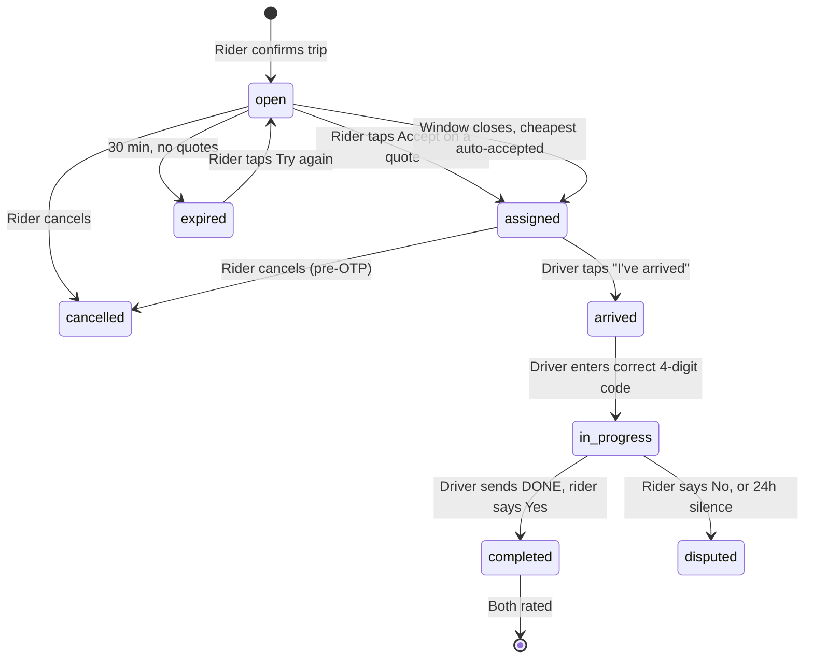

# V3 — WhatsApp Auto Booking

> **Auto Board** — a WhatsApp-first lead platform connecting riders with nearby auto drivers in mid-tier Karnataka towns.

## Documents

| Doc | Contents |
|---|---|
| `overview.md` | This file — product, rules, routing, schema, lifecycle, analytics |
| `flows/rider.md` | Rider state machine, priority tables, edge cases |
| `flows/driver.md` | Driver state machine, priority tables, edge cases |
| `admin.md` | Admin dashboard pages, API, editable settings |
| `testing.md` | WhatsApp simulator (CLI) and vitest suites |
| `local-setup.md` | ngrok tunnel, Meta webhook config, debugging |

## What this is

A rider posts a trip. Nearby drivers are notified and reply with **their own price**. The rider picks one. Payment goes rider → driver, offline. Drivers pay a **flat subscription** for access to leads.

**This is not an aggregator.** The platform never sets, suggests, or collects a fare. It takes no commission, guarantees no service, and handles no payment. It publishes demand and takes a subscription for access to it — like a classifieds board.

| | Aggregator (Uber/Ola) | This platform |
|---|---|---|
| Price | Platform sets it | **Driver quotes it** |
| Matching | Platform assigns | **Rider chooses** |
| Money | Platform collects, takes cut | **Rider pays driver directly** |
| Revenue | Commission per ride | **Flat driver subscription** |
| Supply | Drivers must onboard | **Office can seed drivers; they just reply with a number** |

## Target context and why WhatsApp

Riders are less tech-literate, use WhatsApp but won't install an app, and live in towns where the current options are *walk to the auto stand* or *call the one driver you know*. WhatsApp is already installed, understood, and needs no account.

Consequences that drive the whole design:

- **No free-text typing** — buttons, lists, and numbers only
- **Location via WhatsApp's native location attachment** (which includes a search box) — never typed addresses
- **Kannada-first**, with an English toggle
- **Latency expectations are relaxed** — a rider in a mid-tier town does not expect an auto in 5 minutes

## Hard rules

1. **One WhatsApp number**, role-based routing. Role is chosen once at first contact and is permanent; office staff can override a mistake.
2. **A driver can never book a ride. A rider can never receive a lead.**
3. **Price is always driver-quoted.** The platform never computes, anchors, or displays a price in v1.
4. **Money is integer paise.** No floats, ever.
5. **One active trip per rider and per driver**, enforced by partial unique indexes in Postgres — not by application logic.
6. **No chat relay.** Phone numbers are revealed to both parties only after assignment.
7. **No online payments.** Subscription is recorded by office staff after offline cash/QR.
8. **No driver-side online/offline toggle.** Drivers are always in the matching pool; if they are not active they simply do not reply. Presence is inferred passively from delivery/read receipts and reply history.

## Routing

Every inbound message hits one webhook. Role is resolved in this order:

| Priority | Condition | Action |
|---|---|---|
| 1 | Session exists | Use `session.role` → rider or driver handler |
| 2 | No session, phone found in `drivers` | Recreate session with `role = 'driver'` |
| 3 | No session, phone found in `riders` | Recreate session with `role = 'rider'` |
| 4 | Not in either table | New user → `role_selection` buttons (Rider / Driver) → `awaiting_role` |

`conversation_sessions.role` is required because `idle` is shared by both flows — `state` alone cannot disambiguate rider-idle from driver-idle.

Office-seeded drivers fall into case 2 on their first message without any signup conversation.

## Architecture

Stack:

| Layer | Choice |
|---|---|
| Backend | Node.js + Express + TypeScript |
| Data / storage | Supabase (PostgreSQL + PostGIS + Storage) |
| Ephemeral state | `conversation_sessions` table + pg_cron |
| Messaging | Meta WhatsApp Cloud API |
| Admin | React + TypeScript |

**Addition: a transport-agnostic message layer.** Flow code emits an abstract message spec (`{ text, buttons[], list, location, flow }`); a thin adapter renders it for WhatsApp. Same flow code can render to a native driver app later. Cheap now, expensive to retrofit.

## Environment and database

| Item | Value |
|---|---|
| Database | Supabase (PostgreSQL + PostGIS), credentials in `.env` |
| Schema file | `server/supabase/schema.sql` — single file, drop-and-recreate |
| Applying it | **Destructive.** Every application table is dropped and recreated, so any existing data is lost. Take a dump first if it matters |
| `conversation_sessions.role` | Constrained to `('rider', 'driver')` |
| `events.type` | Plain `text`, not an enum — event names change as the product does |
| Storage | One private bucket (`kyc`) for driver documents. Public URLs always return `400`; use signed URLs |
| pg_cron | `v3-cleanup` every 5 minutes: expired OTPs, stale sessions, auto-dispute. Anything that must send a message runs in the Node scheduler instead, because pg_cron cannot |
| Tests | `truncateAll()` wipes every table. It is destructive and requires `ALLOW_DESTRUCTIVE_TESTS=true` |

Because the suite and the admin UI share one database, **`npm test` deletes
whatever is in it**. Do not enter real driver data while tests are being run.

## Data model

```
riders(id, phone, name, preferred_language, home_lat, home_lng, home_text,
       rating_avg, rating_count, created_at)

drivers(id, phone, name, vehicle_no,
        base_lat, base_lng, base_text, radius_km,
        approval_status,                       -- pending | approved | suspended
        kyc_aadhaar_url, kyc_aadhaar_back_url, kyc_selfie_url,
        aadhaar_no, vehicle_verified, vehicle_verified_at,
        kyc_verified_by, kyc_verified_at,
        subscription_until, trial_ends_at,
        rating_avg, rating_count, last_reply_at, created_at)

trips(id, trip_number, rider_id, driver_id, status,
      pickup_lat, pickup_lng, pickup_text,
      drop_lat, drop_lng, drop_text,
      distance_km,
      pickup_at,                               -- NULL = "now"; set for scheduled
      quote_window_closes_at,
      code_4digit,
      quoted_amount_paise, reported_fare_paise,
      created_at, first_quote_at, assigned_at, arrived_at,
      started_at, done_at, completed_at, cancelled_at,
      cancel_reason, cancelled_by)

quotes(id, trip_id, driver_id, amount_paise, status, created_at)
       -- status: pending | accepted | withdrawn | lapsed

lead_dispatches(id, trip_id, driver_id, distance_km,
                sent_at, delivered_at, read_at)   -- presence + analytics

subscriptions(id, driver_id, paid_at, paid_amount_paise, paid_via,
              valid_until, recorded_by)

conversation_sessions(phone PK, role, state, current_trip_id, data JSONB, updated_at)

trip_otps(trip_id PK, code, expires_at)

events(id, at, actor_role, actor_id, trip_id, type, properties JSONB)

bot_messages(id, phone, direction, role, message_type, body,
             trip_id, session_state, raw_payload, created_at)

settings(singleton: quote_window_minutes, max_drivers_per_lead,
         default_radius_km, radius_options, auto_pick_cheapest,
         fare_check_enabled, trial_days, trial_min_rides, dispute_hours,
         subscription_price_paise, renewal_contact)
```

**Constraints that carry the correctness load:**

```sql
CREATE UNIQUE INDEX one_active_trip_per_rider
  ON trips (rider_id) WHERE status IN ('open','assigned','arrived','in_progress','disputed');

CREATE UNIQUE INDEX one_active_trip_per_driver
  ON trips (driver_id) WHERE status IN ('assigned','arrived','in_progress','disputed');
```

Note the driver index excludes `open`: a driver may hold quotes on many open trips, but may only ever have one that has been assigned to them.

**Matching** uses PostGIS:

```sql
SELECT ... FROM drivers
WHERE approval_status = 'approved'
  AND (subscription_until IS NULL OR subscription_until > NOW())
  AND ST_DWithin(base_point::geography, pickup_point::geography, radius_km * 1000)
ORDER BY distance ASC LIMIT max_drivers_per_lead;
```

## Trip lifecycle



## Quote mechanics

1. Trip is created → matched drivers each receive a lead: *"Gandhi Circle → Bus Stand, 1.8 km. Reply with your price (e.g. 70)."* Lead also carries a `quote_{tripId}` button for drivers who prefer tapping.
2. Driver replies with a number. That becomes a `quote`.
3. **Each quote is pushed to the rider as it arrives**, with driver name, vehicle number, rating, distance, and an `Accept` button.
4. Rider taps Accept → assignment.
5. **At window close**, if the rider has not accepted anything, the cheapest quote is auto-accepted (setting `auto_pick_cheapest`).

### The double-assignment guard

A driver may have quotes out on several open trips, so two riders could tap the same driver at nearly the same instant. The assignment is:

```sql
UPDATE trips
   SET driver_id = $1, status = 'assigned', assigned_at = NOW()
 WHERE id = $2 AND status = 'open'
RETURNING id;
```

combined with `one_active_trip_per_driver`. The second concurrent assignment violates the partial unique index, the transaction rolls back, and that rider is told *"that auto just took another trip — here are your other quotes"*. **Postgres guarantees it; no application-level locking, no WhatsApp-level coordination.**

When a driver wins a trip, their other pending quotes are set to `withdrawn` and those riders are notified.

## Scheduling

Rider chooses **Today / Tomorrow** then an **hour** from a list — two taps, no typing. `pickup_at` is stored; `quote_window_closes_at = pickup_at`.

Leads for a scheduled trip go out ~2 hours before `pickup_at` (pg_cron). Scheduling is not just a convenience — it gives drivers hours to respond instead of minutes, which is the main mitigation for low driver response rates.

## Completion, cancellation, dispute

| Stage | Rule |
|---|---|
| On the way | Driver taps **I am on the way**; the rider is told someone is actually moving. Skipping it is allowed - tapping *I've arrived* still works |
| Navigate | Driver gets a separate Google Maps directions link for the pickup, and another for the drop once the trip starts |
| Start | Rider is shown a 4-digit code on assignment, says it aloud at pickup; driver sends the code or taps **Rider dropped** → `in_progress` |
| Cancel | Rider may cancel any time **before** the OTP is verified. Driver may cancel after accepting. Both are asked for a **reason** (predefined list, with *Other* prompting for typed text) before the cancellation is final |
| Driver drops out | The trip is reopened, other nearby drivers are **re-dispatched immediately**, and the rider is told another auto is being found. Without the re-dispatch the rider would wait out the whole quote window with nobody alerted |
| End | Driver sends `DONE` → rider gets Yes/No |
| Dispute | Rider says No, or does not respond within `dispute_hours` (default 24) → `disputed`, flagged for office |
| Rating | Both directions, 1–5, after completion |
| Fare check | Optional (setting, off by default in MVP): *"Ramesh quoted ₹70 — did you pay ₹70?"* Feeds quoted-vs-paid data |

## Subscription

Trial = `trial_days` (default 30) **and** at least `trial_min_rides` completed — never charge a driver on a calendar alone if rider demand was thin. When lapsed: **no leads**. The bot tells the driver plainly and gives the renewal contact. Office records payment offline into `subscriptions` and extends `subscription_until`.

## Location

Both pickup and drop use WhatsApp's native location attachment (it has a built-in search box). If the user types text instead, it is stored as `pickup_text` / `drop_text` and the trip proceeds — the driver sees the description. This handles users who cannot or will not attach a location.

**Readable addresses.** Coordinates are never shown to a user. In order of
preference we use: the place name WhatsApp supplies (e.g. *Bus Stand*) → a
reverse-geocoded address → a trimmed version of WhatsApp's own address blob.
Trimming drops country, state, PIN code and Plus Codes (`XF7H+8R3`), and keeps
about three parts, so a line reads `6th Block, Sir MV Layout` rather than
`… Bengaluru, Karnataka 560110, India`.

The geocoder is pluggable via `GEOCODER` (`nominatim` by default — free, no key;
`google` with `GOOGLE_MAPS_API_KEY`; `off`). It is best-effort: if it fails or
times out (3s) the trip proceeds with coordinates only, and the driver still
sees a Navigate link. Tests stub it, so the suite never hits the network.

**Future (data-driven):** cluster historical pickup/drop points by geohash, then suggest nearby known places as buttons. A curated `places` table comes only after that data exists.

## Analytics

The point of v1 is to learn, so instrumentation is part of the MVP, not a follow-up.

**One append-only `events` table.** Never `UPDATE`, never `DELETE`. `properties JSONB` means new fields need no migration. Inserts are fire-and-forget and never block the message path.

Event types: `trip_created · lead_sent · lead_delivered · lead_read · quote_received · quote_accepted · quote_withdrawn · trip_assigned · pickup_started · driver_arrived · otp_verified · done_marked · completed · cancelled · expired · disputed · rated · fare_reported · user_deleted`

Timestamps are denormalised onto `trips` so the funnel is a single row scan: `created_at → first_quote_at → assigned_at → arrived_at → started_at → done_at → completed_at`.

Nightly pg_cron rollups: `driver_daily`, `route_daily` (pickup/drop geohash clusters), `daily_summary`.

**The five numbers that decide this business:**

| Metric | Definition | Why |
|---|---|---|
| Driver response rate | quotes ÷ leads delivered | the make-or-break number |
| Median time to first quote | `first_quote_at − created_at` | whether the product feels alive |
| Unclaimed rate | trips expiring with zero quotes | supply gaps by area and hour |
| Repeat rider rate | riders with ≥2 trips in 30 days | habit vs novelty |
| Messages per completed trip | `bot_messages ÷ completed` | unit cost |

Also log every inbound/outbound message to `bot_messages` for debugging and cost accounting.

**Retention:** precise lat/lng is sensitive. Drop exact coordinates after 90 days, keep geohash clusters.

## WhatsApp platform notes (open gaps)

| Item | Status |
|---|---|
| **Utility template messages** | **Must build.** `api.ts` sends only free-form messages today. A driver who has not messaged for 24 hours falls outside the session window and cannot receive a lead at all. Critical. |
| `statuses` webhook (`sent`/`delivered`/`read`) | **Must build.** This is how presence is inferred without asking the driver anything. Also feeds `lead_delivered` / `lead_read` analytics. |
| WhatsApp Flows | Available (`TextInput` with `input-type: number` and regex, `DatePicker`, up to 100 screens, 50 components/screen, 30-char CTA; response arrives as `interactive.nfm_reply.response_json`). **Deferred** — v1 uses buttons for scheduling. Later candidates: structured quote form, proper date picker. |
| Role selection | Two reply buttons — Rider / Driver |
| i18n | Kannada default, English toggle |

## Out of scope for v1

Documented, deliberately deferred:

- **Driver rate card / standing rates** — pending evidence on whether drivers will commit to a rate
- **Browsable trip board** — v1 is pushed leads only
- **Nearby-place suggestions** and a curated `places` table — needs trip data first
- **Daily driver digest nudges** (*"You missed 5 riders yesterday"*) — TODO, not MVP
- **Native driver app** — the transport-agnostic message layer is the preparation
- **Radius escalation** when a trip gets no quotes — v1 expires at 30 min and offers Try again
- **Radius widening / multi-town** — v1 is effectively one locality
- Voice-note destination, photos, chat relay, in-app payments

## Implementation order

1. `server/` scaffold — Express, config, Supabase client, webhook, health
2. `schema.sql` — apply (**destroys any existing data**)
3. Test engine + CLI simulator (`testing.md`) — before the flows, so every flow is born testable
4. Role resolution and session store
5. Rider flow (`flows/rider.md`)
6. Driver flow incl. KYC (`flows/driver.md`)
7. Matching + lead dispatch + quote mechanics
8. Scheduled-trip cron, expiry cron, auto-dispute cron
9. Admin API + dashboard (`admin.md`)
10. Analytics events and rollups

## Open questions / TODO

1. Trial length and price point (₹/month) — undecided
2. Whether the rider sees the driver's rating before accepting (assumed **yes**, needed to choose)
3. Whether a driver who cancels repeatedly should be auto-suspended — policy not set
4. ~~KYC depth at launch~~ — resolved: WhatsApp upload (Aadhaar front/back + selfie, skippable), reviewed by office in Admin → Driver Detail. Office may still approve a driver with no documents if verified face to face.
5. Exact `max_drivers_per_lead` — start at 25, tune from response-rate data
